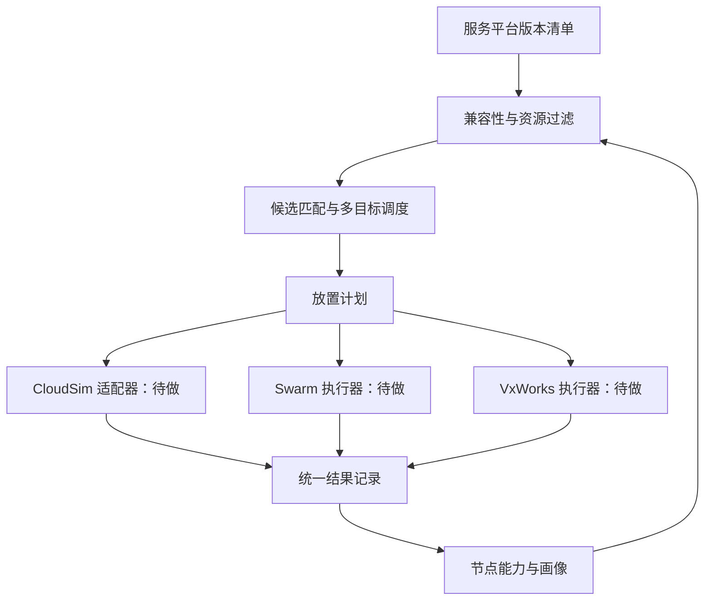

# 1019 需求与技术方案 v1

日期：2026-10-19。课题：面向异构操作系统的微服务跨平台部署与适配优化算法研究。

## 1. 先给结论

课题按“统一描述 → 兼容过滤 → 多目标决策 → 分平台执行 → 采样反馈”推进。用户已确认暂时没有实验环境，本阶段交付本机仿真和算法原型。

本版是静态模型和合成数据实验，没有真实部署，也没有把 Python 模型称作 CloudSim。图片要求的 CloudSim 与 Docker Swarm 集成仍是后续交付项。原型用于检查算法思路、数据结构和约束。

## 2. 图片需求拆解

|图片要求|具体工作|本版状态与验收|
|---|---|---|
|系统调用、资源、驱动、安全差异|节点能力与平台版本清单|字段和规则已实现；真实能力待 SDK/实机取证|
|微服务—异构节点适配模型|OS、架构、运行时、ABI、接口、驱动、安全、资源、响应约束|硬过滤、失败解释与软评分已实现|
|兼容性、资源匹配度、实时性指标|静态候选覆盖、接纳率、预留利用率、响应估计|已建模；不是实测或 RTOS 时序证明|
|成功率高、利用率高、部署延迟低|三目标记录；按接纳数优先、其余目标加权推荐|已实现束搜索与已搜索解集的 Pareto 集|
|CloudSim＋Docker Swarm，三类 OS 节点|仿真和实机分层，共用输入及校准数据|未集成；Python 原型不替代该项验收|
|响应延迟、资源占用率、崩溃率采集|真实节点采样并回填画像|当前全为合成值，没有崩溃率实验|
|资源与依赖特征提取、快速匹配|显式清单起步，后续解析构建与采样信息|清单匹配已做；自动依赖提取未做|
|设计、实现、功能及算法验证|方案、说明、测试、独立穷举、重复实验|本版交付；实机验证待后续|

图片明确列出的测试节点为 Ubuntu Server、Windows Server、VxWorks。FreeRTOS 出现在背景举例中，本版不扩展为第四个必做节点。模糊文字不自行补成强制要求。

## 3. 技术边界与官方证据

### Linux 与 Windows

微软文档说明了混合 OS Swarm 和节点标签限制部署。[S1] Docker 提供 node.platform.os、node.platform.arch、node.labels 等约束。[S2] 本方案设计为外部算法输出目标节点和平台版本，由执行器固定到选中节点；只限制 OS 而任由 Swarm 再分配节点，会使实际方案偏离算法结果。

Linux 与 Windows 应分别构建平台版本。Windows 镜像、宿主版本与隔离模式必须按微软矩阵核验，不能只比较 windows 字符串。[S3] 原型 ABI 字段是示例兼容类，后续要填入实测通过的兼容类，没有模拟完整 Windows 兼容矩阵。

### VxWorks

风河官方介绍了 OCI 容器和通过镜像仓库交付应用。[S4] 这不能证明任意 VxWorks 环境能作为 Swarm worker。本方案预留独立执行接口，待明确 SDK、内核组件、板卡/BSP 和许可条件，再选择 RTP 或该版本支持的容器方式。

风河公开仓库提供 SDK 与 QEMU 示例，可作为后续无硬件路线的依据。[S5] 宿主 Docker 构建与目标 VxWorks 运行要分开描述。本版 rtp 标签只是计划中的执行通道，没有调用 RTP 接口。

### CloudSim

CloudSim 官方项目支持云资源及应用容器建模。[S6] 后续需固定发布版本和依赖，避免照抄旧 API。查阅时发行页列有 7.0.1，可作为候选版本，尚未构建验证。[S7]

本方案把“CloudSim＋Docker Swarm”解释为：前者做可重复的大规模仿真，后者做 Linux/Windows 真实部署，以共同工作负载和实测校准值连接。现有证据不足以认定有直接运行三种系统的现成组合，这一具体解释应在实施该阶段前与导师确认。

## 4. 架构与实现范围

当前覆盖清单、过滤、调度、静态部署时间估计与结果记录，三个外部适配器尚未实现。服务协议和业务逻辑可以复用，每个平台版本仍需要对应构建产物，不能把一个二进制文件默认视作跨 OS 通用。

## 5. 数据与适配模型

节点包含 id、os、arch、runtime、abi、apis、drivers、security、cpu_mcpu、memory_mib、speed、pull_mib_s、network_ms。平台版本包含兼容字段，以及 cpu_mcpu、memory_mib、exec_ms、image_mib、startup_ms。服务另有 security、deadline_ms 和多个 variants。

- CPU 预留量单位 mcpu，1000 对应一个逻辑核的配额尺度，不代表跨处理器相同性能。
- 内存与镜像大小单位 MiB；时间 ms；拉取速率 MiB/s。
- speed 是合成计算速度系数，实机阶段应由固定工作负载校准。
- security 是示例有序能力等级，不是认证等级；后续改成显式能力集合与策略。
- ABI、接口、驱动必须配置或测量，不能从 OS 名称推断。

C(s,v,n)=1 当且仅当：四个平台字段匹配；接口、驱动要求为节点能力子集；安全能力满足要求；单版本资源不超节点容量；响应估计不超过服务截止期。没有任何候选的服务输出逐节点、逐版本失败原因。

响应估计 R=exec_ms/speed+network_ms。没有排队、负载干扰、抖动或优先级抢占，因此截止期过滤只对该静态模型成立，不证明真实 RTOS 的可调度性。

通过硬过滤后，候选适配分数：

A=0.5×(1−R/deadline)+0.25×(1−cpu_req/cpu_cap)+0.25×(1−mem_req/mem_cap)。

分数用于候选顺序和解释，不能用高分弥补 ABI 或驱动不兼容；它是启发式评分，不是实测成功概率。

## 6. 部署优化模型

令 x(s,v,n)∈{0,1}。每个服务最多选择一个版本和一个节点，拒绝对应全零。必须满足 x≤C，每节点 CPU 和内存预留总量分别不超容量。所有接纳服务持续并发存在，不跨时间复用预留资源。

三个目标为：

1. 最大化 P=接纳服务数/请求服务数。
2. 最大化 U=0.5×(CPU 总预留/活跃节点 CPU 总容量＋内存总预留/活跃节点内存总容量)。
3. 最小化 T=max_n Σ_(部署于n的版本)[1000×image_mib/pull_mib_s＋startup_ms]。

T 假设节点内串行部署、节点间并行、每次冷拉取、无链路争用。它不包含业务执行时间和响应网络时间。没有部署时 U=0、T=0；没有请求时定义 P=1。

另报告全节点预留利用率，避免只选少数节点就宣称集群效率提高。不同平台版本的预留需求不同，指标依赖画像质量；高预留率也可能带来实际争用，实机需同时检查 P95/P99 和截止期违约率。

推荐解先比较接纳数；相同接纳数再最小化 J=α(1−U)+(1−α)T/T_ref。本版预先固定 α=0.5、T_ref=60000 ms，不按结果回调。T_ref 是尺度常数，不是硬上限。另保存搜索结束后的完整解非支配集；这不是全局 Pareto 前沿。

## 7. 算法与对照

方法：兼容过滤 → 按候选节点稀缺度排序服务 → 有限宽度束搜索 → 完整解非支配集 → 按既定偏好推荐。

每层处理一个服务，展开所有可行放置和拒绝分支，按推荐偏好保留前 B 个状态。只在终点计算非支配集，不把不同剩余资源的部分解当成严格可支配状态删除。有限束宽仍会裁掉潜在好解，不保证全局最优。

候选生成约 O(SNV)。每层最多 B(NV+1) 个扩展，排序约 O(BNV log(BNV))；本实现还复制与计算节点资源向量，需要 O(N) 因子；末端非支配集约 O(B²N)。关闭束宽后枚举所有状态，只用于小例。

|方法|服务顺序|选择规则|用途|
|---|---|---|---|
|first_fit|输入顺序|首个可行节点/版本|基础方法|
|round_robin|输入顺序|从游标轮询可行节点|基础方法|
|best_fit|输入顺序|目标节点放置后 CPU/RAM 平均剩余比例最小|紧凑放置|
|beam_input|输入顺序|同一束搜索|去掉稀缺度排序的消融|
|beam_scarcity|候选节点少者优先|束搜索|本版候选研究方法|

所有方法使用相同硬约束和输入。基础方法为自编对照，不代表 Swarm 内部调度的完整实现。与前三者比较观察整体方案；与 beam_input 比较观察稀缺度排序。顺序、束宽和权重都可能影响结论。

## 8. 验证与后续实验

当前四场景：balanced、pressure、heterogeneous、incompatible。每场景十个配对种子，每组输入给五种算法，共 200 次求解。保存全部输入、分配、参数、指标和求解耗时，报告均值与样本标准差。incompatible 特设不存在的架构/ABI，验证拒绝行为。

功能检查逐项破坏硬约束，核验资源聚合、截止期边界、单位换算、版本唯一性、节点串并行时间；独立小例枚举重算最优成本及完整非支配集；固定种子验证确定性。

后续补独立留出数据、B∈{8,24,64}、α∈{0.2,0.5,0.8} 的敏感性分析，以及缓存、网络争用、负载变化、调用图和自动依赖抽取。小例检查正确性，合成对比检查趋势，实测验证工程有效性，三者不能替代。

真实采样至少记录：时间戳、服务与版本、OS/build/arch、负载档位、CPU、RSS/工作集、请求数、P50/P95/P99、异常退出次数与观察窗口、拉取起止、健康就绪。崩溃率需明确分母，例如每服务运行小时的异常退出次数。

## 9. 后续交付与验收

|阶段|交付|验收|
|---|---|---|
|本机原型，当前|方案、代码、测试、示例、重复实验|可运行，约束与独立小例通过，结果可追溯|
|CloudSim 扩展|固定版本构建、模型映射、同输入结果|时间语义清楚，可重复，校准误差记录|
|Linux/Windows|分平台构建、Swarm 执行器、采样|实际健康就绪，节点/镜像版本记录，失败恢复|
|VxWorks|选定 SDK/BSP 的 RTP 或容器执行器|目标上实际运行采样；QEMU 结果明确标注|
|研究结论|基线、消融、敏感性、真实负载|说明改进和退化条件，不预写提升百分比|

创新候选是跨 OS 能力约束与依赖画像结合，以及稀缺候选保护与部署成本协同优化。是否构成创新需相关工作查重和实测支撑；本版不宣称首次提出。

## 10. 官方来源

核查日期：2026-10-19。来源确认工具边界；算法、评分、模型假设为本方案设计。

- [S1 微软：混合 OS Swarm](https://learn.microsoft.com/en-us/virtualization/windowscontainers/manage-containers/swarm-mode)
- [S2 Docker：节点约束](https://docs.docker.com/reference/cli/docker/service/create/)
- [S3 微软：Windows 容器版本兼容](https://learn.microsoft.com/en-us/virtualization/windowscontainers/deploy-containers/version-compatibility)
- [S4 风河：VxWorks 产品概览与 OCI 容器](https://www.windriver.com/sites/default/files/2024-03/602982_VxWorks-Product-Overview.pdf)
- [S5 风河：VxWorks 7 SDK/QEMU 示例](https://github.com/Wind-River/vxworks7-ros2-build)
- [S6 CloudSim 官方项目](https://github.com/Cloudslab/cloudsim)
- [S7 CloudSim 官方发行记录](https://github.com/Cloudslab/cloudsim/releases)
