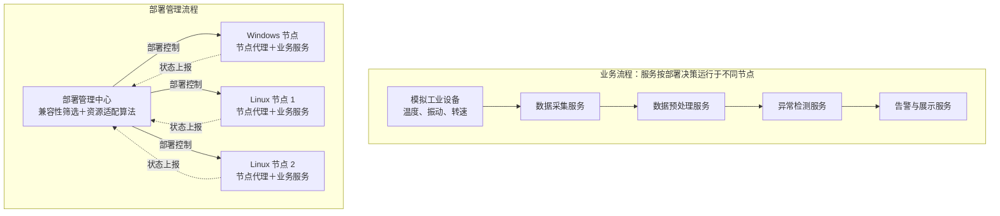

# 面向工业设备状态监测的异构操作系统微服务部署与资源适配方法研究

> 工业互联网安全课程项目总体方案  
> 编写日期：2026年10月19日  
> 适用成果：PPT 汇报、代码及展示、小论文  
> 当前阶段：总体设计。本文明确项目框架、环境方案及主要实施阶段，暂不展开安装命令、接口定义和代码实现细节。

## 1. 项目定位与目标

本项目构建一套能够跨 Windows、Linux 运行，并根据节点资源情况选择服务部署位置的工业设备状态监测系统。

选择“车间电机设备状态监测”作为具体场景，先模拟多台电机的温度、振动和转速数据，完成数据采集、预处理、异常检测和告警展示。后续具备条件时，可以接入真实设备。

项目的核心研究问题是：

> 在满足操作系统兼容性和资源约束的前提下，如何选择工业监测微服务的部署位置，降低业务响应时间并改善节点负载分布？

主要目标包括：

1. 实现完整的工业设备状态监测业务链。
2. 建立 Windows、Linux 异构节点的统一描述与管理机制。
3. 实现服务兼容性筛选和资源适配部署方法。
4. 通过对比实验评价方法的效果，并形成课程交付材料。

## 2. 项目范围

基础版本按以下规模开展：

- **工业场景**：车间电机状态监测。
- **设备数据**：模拟温度、振动和转速，包含正常及异常状态。
- **操作系统**：Windows 与 Linux 两类。
- **工作节点**：一个 Windows 节点、两个 Linux 节点。
- **业务服务**：采集、预处理、异常检测、告警与展示。
- **运行方式**：优先采用原生 Python 进程，通过统一节点代理管理；Docker 作为后续扩展。
- **部署能力**：初始部署，以及负载变化后的重新部署。
- **异常检测**：先采用阈值或滑动窗口统计方法；若课程后续明确需要 AI 模型，再替换检测模块。

基础版本优先对无状态的预处理、检测服务开展重新部署，通过停止旧实例、启动新实例完成。状态迁移、复杂集群编排、RTOS 设备和真实工业硬件接入留作扩展。

## 3. 项目整体框架

### 3.1 两条主要流程

**业务流程：**

模拟设备数据 → 数据采集 → 数据预处理 → 异常检测 → 告警与展示。

**部署管理流程：**

节点状态采集 → 服务兼容性判断 → 部署位置选择 → 执行部署 → 运行效果监测。

### 3.2 系统架构

业务流程表示服务之间的数据关系，部署管理流程表示服务与运行节点之间的管理关系。部署管理中心可以与其中一个工作节点共用机器。

### 3.3 模块划分

| 模块 | 主要职责 | 在项目中的作用 |
|---|---|---|
| 模拟设备端 | 生成正常、异常及不同频率的设备数据 | 提供可重复的工业业务负载 |
| 业务微服务 | 完成采集、预处理、异常检测和告警 | 形成完整的设备监测业务链 |
| 节点代理 | 上报操作系统、CPU、内存、运行环境，执行服务启动与停止 | 连接管理中心与异构节点 |
| 部署管理中心 | 管理服务需求、节点能力和部署结果 | 实现跨平台统一管理 |
| 资源适配算法 | 从兼容节点中选择适合部署的位置 | 承载核心研究方法 |
| 展示与实验模块 | 展示设备状态、节点负载、部署位置和性能指标 | 支撑代码演示与论文实验 |

## 4. 异构适配与部署方法

### 4.1 服务需求与节点能力

| 对象 | 需要描述的主要信息 |
|---|---|
| 服务需求 | 支持的操作系统、依赖环境、预计 CPU 和内存需求、上下游服务关系 |
| 节点能力 | 操作系统、可用资源、已安装运行环境、当前负载、网络连接情况 |

异构性需要体现在实际运行环境及可检查的兼容性约束中。如果某个采集服务依赖 Windows 专有接口，只能将其部署到兼容节点；如果采用模拟采集，应明确说明模拟的接口依赖，不能将其当作真实硬件适配成果。

仅在同一套 Linux 环境中启动多个容器，不能充分体现 Windows、Linux 操作系统之间的适配问题。

### 4.2 拟采用的方法

基础方法采用“**兼容性筛选＋资源与通信开销综合评分**”：

1. 根据操作系统、运行依赖和资源要求，筛选可行节点。
2. 综合考虑可用 CPU、内存及服务间通信开销，对可行节点进行评分。
3. 生成部署方案，由节点代理执行并记录结果。

负载发生变化后，重新评估部署方案，并对选定的无状态服务执行重新部署。评分指标、权重和触发条件在后续详细设计阶段确定。

## 5. 环境搭建方案

### 5.1 推荐部署环境

采用“**Windows 主机＋两台 Ubuntu 虚拟机**”，构成两类操作系统、三个工作节点。

| 环境部分 | 建议配置 | 用途 |
|---|---|---|
| Windows 节点 | Windows 10/11，原生运行节点代理和部分业务服务 | 代表工业现场工控机 |
| Linux 节点 1 | Ubuntu 24.04 LTS 虚拟机 | 代表边缘计算节点 |
| Linux 节点 2 | Ubuntu 24.04 LTS 虚拟机，配置不同资源额度 | 提供部署选择和负载对比 |
| 编程环境 | Python 3.11，各节点使用独立虚拟环境 | 统一开发和依赖管理 |
| 服务接口 | FastAPI＋HTTP | 服务管理、状态上报和控制 |
| 业务通信 | MQTT，采用 Mosquitto 消息代理 | 传输设备监测数据 |
| 资源采集 | psutil | 获取节点与进程资源状态 |
| 数据记录 | SQLite＋实验结果文件 | 保存监测、部署和实验记录 |
| 展示界面 | Streamlit | 展示设备、节点、部署和性能变化 |
| 容器工具 | Docker，作为可选扩展 | 封装 Linux 服务及公共组件 |

psutil 支持 Windows、Linux 等平台的进程与系统资源采集，可用于统一监控接口。具体能力见 [psutil 官方文档](https://psutil.readthedocs.io/stable/index.html)。

### 5.2 环境搭建的主要工作

- 准备 Windows、Ubuntu 系统及节点之间的网络连接。
- 在各节点准备统一的 Python 版本和项目依赖。
- 准备消息代理、数据记录及展示组件。
- 部署节点代理，验证状态上报和服务启停。
- 固定实验使用的系统版本、软件依赖和节点资源配置。

以上仅列出环境搭建的工作范围，具体安装与配置步骤在实施时另行细化。

### 5.3 硬件与替代方案

- 单机运行三节点原型，建议至少 16 GB 内存，32 GB 更充裕；实际需求取决于虚拟机配置。
- 有多台电脑时，可以分散部署，降低单机压力。
- 初期采用 CPU 即可，不需要 GPU 或真实 PLC。
- 设备资源有限时，可以先用 Windows 原生进程与 WSL2 中的 Ubuntu 联调。配置依据见 [微软 WSL 安装说明](https://learn.microsoft.com/en-us/windows/wsl/install)。

单机虚拟环境适合验证功能和比较方法，但各节点共享物理硬件。论文需交代该条件，避免将结果直接解释为真实分布式工业网络中的性能。

## 6. 完成项目的主要阶段

| 阶段 | 主要工作 | 阶段成果 |
|---|---|---|
| 1. 明确场景与研究范围 | 确定设备类型、数据指标、业务链、服务约束和评价目标；开展针对性文献调研 | 项目需求说明、研究问题、总体方案 |
| 2. 搭建异构实验环境 | 建立 Windows、Linux 节点，准备运行环境并打通网络通信 | 可以互相通信的实验平台 |
| 3. 实现监测业务原型 | 完成模拟数据、采集、预处理、异常检测和告警展示 | 能完整运行的设备监测系统 |
| 4. 实现统一节点管理 | 完成节点注册、资源上报、服务描述、远程启停和部署状态管理 | 可以跨平台管理服务的原型 |
| 5. 实现部署与资源适配方法 | 建立兼容性及资源约束，实现提出的方法和对比方法 | 可以自动生成并执行部署方案的系统 |
| 6. 开展实验与效果分析 | 改变数据负载、节点资源和服务规模，重复实验并分析结果 | 实验记录、对比图表、结论 |
| 7. 完成课程交付 | 整理 PPT、代码与说明、演示材料和小论文 | 三部分相互对应的课程成果 |

中期 PPT 可以在前几个阶段形成，重点介绍研究背景、参考文献、系统架构和拟采用的方法。代码展示与期末论文再结合完整实现和实验结果补充。

## 7. 实验验证框架

### 7.1 对比方法

所有方法应满足相同的兼容性和资源约束，在一致的节点条件与业务负载下比较。

| 方法 | 部署依据 |
|---|---|
| 兼容性约束下的轮询方法 | 在可行节点之间依次分配 |
| 最低负载方法 | 优先选择当前负载较低的可行节点 |
| 本项目方法 | 综合考虑资源需求、节点负载和通信开销 |

### 7.2 实验场景

- 改变模拟设备数量或数据发送频率，比较不同负载下的表现。
- 改变节点资源额度或背景负载，比较资源适配效果。
- 改变服务规模或部署约束，观察部署方案与性能变化。
- 对选定的负载变化场景执行重新部署，记录调整过程及业务表现。

### 7.3 主要评价指标

| 指标 | 评价目的 |
|---|---|
| 端到端响应时间 | 评价设备数据进入系统到产生检测或告警结果的时效 |
| 节点负载均衡程度 | 评价不同节点的负载分布，结合节点能力差异进行解释 |
| 吞吐量 | 评价单位时间内完成处理的数据量 |
| 部署耗时 | 评价从发起部署到服务就绪所需的时间 |
| 部署成功率 | 检查兼容性和资源约束处理是否正确 |

资源充足时，各方法的部署成功率可能都很高，因此该指标不应作为唯一效果指标。实验需保存输入、配置和原始结果，重复运行后再分析，不预设本项目方法一定优于对比方法。

## 8. 课程成果与演示安排

### 8.1 三部分成果的对应关系

| 课程成果 | 主要内容 | 依托的项目材料 |
|---|---|---|
| PPT 汇报 | 工业应用背景、文献、问题定义、架构、方法与阶段进展 | 需求说明、架构图、方法设计、阶段结果 |
| 代码及展示 | 跨平台业务运行、节点状态、自动部署及负载变化演示 | 系统代码、配置、启动说明、演示材料 |
| 小论文 | 问题建模、部署方法、实验设计、结果分析与局限 | 系统实现、实验数据、图表、参考文献 |

### 8.2 推荐演示流程

启动设备监测 → 展示跨平台部署 → 增加设备数据量或节点负载 → 重新计算并执行部署 → 展示部署位置和性能变化。

展示界面应能够说明设备是否正常、服务运行在哪个节点、节点资源情况如何，以及部署调整前后发生了哪些变化。

## 9. 基础版本完成标准

- Windows、Linux 节点均实际运行节点代理和相应业务服务。
- 模拟设备数据能够经过完整业务链，产生监测结果与告警。
- 管理中心能够读取节点状态、检查兼容性并执行部署。
- 本项目方法与两种对比方法能够在相同条件下运行。
- 能够展示一次负载变化后的部署调整及对应测量结果。
- PPT、代码说明和小论文使用一致的系统设计与真实实验结果。

## 10. 后续详细设计内容

总体方案确认后，再逐项细化项目目录、服务接口、数据格式、节点配置、评分方法、部署触发条件、实验参数与运行操作说明。
