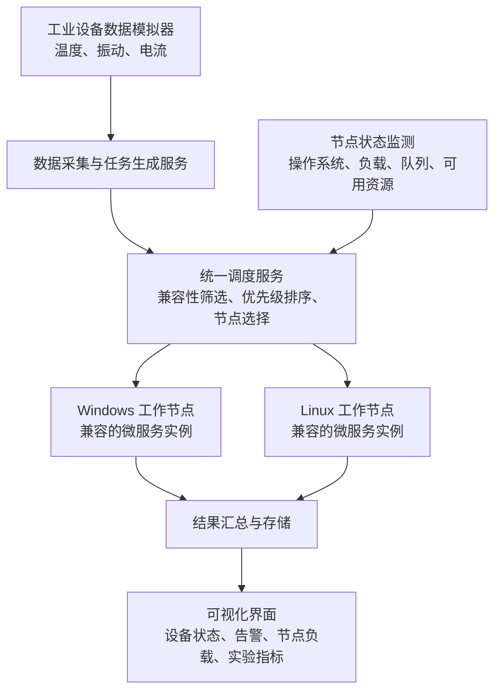

# 面向工业异常告警的异构操作系统微服务优先级调度方法研究

> 文档用途：课程项目总体方案，供后续 PPT 汇报、代码及展示、小论文共同使用。
>
> 当前阶段：方案设计，尚未完成环境搭建、代码实现与实验验证。本文只给出整体框架、环境方案和实施阶段，暂不展开安装命令与具体操作步骤。
>
> 编写日期：2026 年 10 月 19 日。

## 1. 项目定位与目标

搭建一个 Windows 与 Linux 协同运行的工业设备监测系统，研究系统繁忙时，如何通过应用层任务调度优先保障关键告警的处理时效，同时兼顾普通任务的处理能力。

项目围绕一个核心研究问题展开：

> 在操作系统兼容性和节点资源约束下，结合任务优先级、截止时间及节点预计完成时间的调度方法，能否降低关键告警的延迟和截止时间违约率，并避免低优先级任务长期等待？

项目目标包括：

1. 建立具有明确工业业务含义的设备监测与异常告警场景。
2. 实现 Windows、Linux 节点之间的微服务通信和任务协同。
3. 设计兼顾兼容性、任务紧迫性和节点状态的调度方法。
4. 通过统一条件下的对比实验，评价方法的效果与代价。
5. 形成一套相互衔接的 PPT、可运行代码与小论文材料。

本项目评价应用层告警处理时效，不作工业控制硬实时保证。所提方法属于待验证的课程项目方案，不预设性能提升，也不宣称已证实的学术创新。

## 2. 工业应用场景与项目范围

### 2.1 应用场景

选择电机或水泵作为监测对象，第一版使用模拟数据生成温度、振动、电流等设备状态信息。系统同时承担实时异常判定与告警、普通状态处理、历史统计等任务。

通过提高数据到达速率、增加统计任务或改变节点资源配额，构建资源竞争场景，观察不同调度策略对关键告警的影响。

### 2.2 任务分类

| 优先级 | 任务示例 | 业务目标 |
| --- | --- | --- |
| 高 | 实时异常判定、告警推送 | 尽量降低响应延迟，减少超时 |
| 中 | 常规设备状态处理 | 保持稳定处理能力 |
| 低 | 历史数据统计、报表计算 | 利用剩余资源，并避免长期等待 |

任务优先级由业务类型预先定义，不依赖事后获得的异常检测结果。各类任务的截止时间将在后续设计阶段结合业务需求和预实验确定。

### 2.3 第一版范围

- 一种工业设备监测场景。
- Windows、Linux 两种操作系统。
- 高、中、低三类任务。
- 两种基准调度策略与一种所提方法。
- 一套运行展示与实验分析界面。
- 以模拟设备数据为主，支持固定参数和重复播放。

RTOS、真实设备接入、动态服务迁移和复杂容器编排可作为后续扩展。

## 3. 系统整体框架

若 Markdown 阅读器不支持 Mermaid，可按以下关系理解主流程：

**模拟设备数据 → 数据采集与任务生成 → 统一调度 → 兼容节点执行 → 结果汇总 → 展示与分析。**

### 3.1 功能模块

| 模块 | 主要职责 | 主要输出 |
| --- | --- | --- |
| 数据模拟与采集 | 生成正常、异常和突发工业数据，支持重复播放 | 设备数据、业务任务 |
| 业务微服务 | 执行异常判定、告警推送、普通状态处理和历史统计 | 业务处理结果 |
| 统一调度服务 | 管理待处理任务，根据兼容性、优先级和节点状态分配任务 | 调度决策、分配记录 |
| 节点执行与监测 | 执行任务，上报操作系统、资源使用和队列情况 | 执行结果、节点状态 |
| 数据记录与展示 | 保存任务生命周期记录，展示运行过程和实验指标 | 日志、数据表、图表 |

### 3.2 两个技术层面

**服务部署与适配：**明确服务依赖、可运行的操作系统、启动方式和访问接口。

**任务调度：**服务启动后，决定一个新任务何时执行、由哪个兼容节点执行。

第一版采用固定服务部署，将主要算法工作集中于任务调度。服务部署成功不等于已经实现调度优化，两部分需分别验证。

### 3.3 异构性体现

- Windows 原生服务与 Linux 服务分别在对应系统中实际运行。
- 采集适配服务可依赖 Windows 接口；分析服务可提供 Windows、Linux 两种运行版本。
- 服务描述中记录操作系统、运行环境、接口依赖和资源需求。
- 节点描述中记录操作系统、可用资源和支持的服务类型。
- 调度器只向满足兼容性约束的节点分配任务。

平台限制应来自实际依赖，或明确标注为实验中的模拟约束，不能将人为配置的限制表述为操作系统固有限制。

## 4. 调度方法总体思路

拟采用以下方法框架：

> **操作系统兼容性筛选 + 优先级与截止时间排序 + 预计完成时间选点 + 等待时间补偿。**

| 环节 | 设计内容 | 目的 |
| --- | --- | --- |
| 兼容性筛选 | 根据操作系统、服务依赖和节点能力筛选可执行节点 | 避免无效任务分配 |
| 任务排序 | 综合业务优先级和截止时间确定处理顺序 | 优先保障关键任务 |
| 节点选择 | 综合排队时间、预计执行时间和通信开销选择节点 | 尽量减少任务完成时间 |
| 等待补偿 | 根据等待时间调整任务调度机会 | 缓解低优先级任务长期等待 |

预计执行时间可在后续根据预实验和历史执行记录估计。具体评分规则、参数、并发数量和是否抢占将在详细设计阶段确定，并在各策略之间保持一致或明确说明差异。

## 5. 环境搭建方案

### 5.1 部署形态

第一版建议使用一台 Windows 电脑和一台 Ubuntu 虚拟机。具备多台电脑时，可进一步部署到局域网中的独立设备。

| 环境 | 承担功能 |
| --- | --- |
| Windows 宿主机 | 数据模拟、调度器、展示界面，以及一个 Windows 工作节点 |
| Ubuntu 虚拟机 | MQTT 消息代理，以及一个 Linux 工作节点 |
| 后续扩展节点 | 增加可选执行位置，研究负载分配与节点规模的影响 |

同一台电脑上的各节点会共享物理资源，实验应记录资源配额并控制后台负载。单机虚拟化实验的结论应限定在测试环境内，不直接推广为不同操作系统的普遍性能差异。

### 5.2 硬件与软件规划

以下为建议配置，尚未核验本机实际安装情况。

| 类别 | 建议方案 | 用途 |
| --- | --- | --- |
| 宿主系统 | Windows 10/11 | 开发及运行 Windows 原生服务 |
| Linux 系统 | Ubuntu 24.04 LTS 虚拟机 | 运行 Linux 服务 |
| 内存 | 建议至少 16 GB；多虚拟节点时 32 GB 更宽裕 | 支撑宿主机、虚拟机及实验负载 |
| 开发语言 | Python 3.12 | 两个系统采用一致的依赖版本 |
| 服务接口 | FastAPI + Uvicorn | 提供微服务与节点管理接口 |
| 数据接入 | MQTT + Mosquitto | 传输模拟设备数据 |
| 调度与执行 | Python 调度器 + 节点执行程序 | 实现任务分配与执行 |
| 状态监测 | psutil | 采集 CPU、内存等信息 |
| 数据保存 | SQLite + CSV | 保存执行记录、导出实验数据 |
| 展示与绘图 | Streamlit + Matplotlib | 运行展示及结果分析 |
| 版本管理 | Git | 保存代码、配置和实验参数 |

FastAPI 通过 Uvicorn 等 ASGI 服务程序运行，参考 [FastAPI 官方部署说明](https://fastapi.tiangolo.com/deployment/manually/)。Mosquitto 用作 MQTT 消息代理，参考 [Mosquitto 官方文档](https://mosquitto.org/documentation/)。

### 5.3 环境搭建的总体内容

1. 建立 Windows 与 Ubuntu 的运行环境和网络连接。
2. 统一两个系统的 Python 环境与项目依赖。
3. 部署消息代理、服务接口和节点执行程序。
4. 配置节点身份、服务能力和兼容性信息。
5. 验证跨系统通信、状态上报和任务执行链路。

第一版可用独立进程运行微服务，容器化作为后续扩展。若使用 Docker Desktop，其 WSL 2 后端中的 Linux 容器仍属于 Linux 运行环境，不能仅凭 Windows 上运行 Docker 就认定已实现 Windows/Linux 异构服务。参考 [Docker WSL 2 后端说明](https://docs.docker.com/desktop/features/wsl/)。

## 6. 项目完成的大步骤

| 阶段 | 主要工作 | 阶段成果 |
| --- | --- | --- |
| 1. 明确场景与研究问题 | 确定监测对象、任务类型、兼容性约束和研究目标；收集相关文献 | 需求说明、研究问题、参考文献 |
| 2. 完成系统与实验设计 | 确定服务划分、节点部署、任务流程、调度方法和评价指标 | 架构图、调度模型、实验方案 |
| 3. 搭建异构运行环境 | 建立 Windows/Linux 环境，实现跨系统通信和基础服务运行 | 可互相访问的异构节点 |
| 4. 实现最小业务闭环 | 打通数据生成、任务处理、异常告警、结果保存和界面展示 | 能完整运行的项目原型 |
| 5. 实现调度方法与对比策略 | 接入节点监测，实现所提方法及基准方法 | 可切换策略的调度系统 |
| 6. 开展实验与分析 | 在不同负载、任务比例和资源条件下重复实验 | 原始记录、对比图、结果分析 |
| 7. 整理课程成果 | 将架构、实现和实验结果整理为汇报、演示和论文 | PPT、代码及运行说明、小论文 |

先打通业务闭环，再接入调度优化。PPT 的背景、相关研究和方案部分可随前两个阶段同步整理；实验结果部分在实际实验后补充。

## 7. 实验设计总体方案

### 7.1 对比策略

| 策略 | 基本机制 | 对比目的 |
| --- | --- | --- |
| 基准一 | 先来先服务 + 兼容节点轮询 | 提供基础性能对照 |
| 基准二 | 固定优先级 + 最低负载选点 | 判断基础优先级机制的效果 |
| 所提方法 | 兼容性筛选 + 优先级与截止时间排序 + 预计完成时间选点 + 等待补偿 | 评价综合策略的收益与代价 |

如需进一步区分各设计环节的作用，可在基础对比完成后补充移除等待补偿等消融实验。

### 7.2 实验场景

- 低负载：验证正常业务与基础处理能力。
- 持续高负载：观察资源竞争下的关键告警表现。
- 突发负载：观察任务短时间集中到达时的调度效果。
- 不同任务比例：改变关键任务与普通任务的占比。
- 不同节点资源配置：观察资源不均衡条件下的任务分配。

具体任务数量、到达速率、运行时长与重复次数将在预实验后确定。

### 7.3 评价指标

| 指标 | 含义 |
| --- | --- |
| 关键告警平均延迟 | 关键任务从提交到结果返回的平均耗时 |
| 关键告警 P95 延迟 | 关键任务延迟的第 95 百分位数，反映尾部延迟 |
| 截止时间违约率 | 未在截止时间内完成的任务占比 |
| 系统吞吐量 | 单位时间完成的任务数 |
| 低优先级任务等待时间 | 观察普通任务是否长期得不到执行 |
| 节点负载与资源利用率 | 观察资源使用及分配情况 |
| 失败、丢弃和未完成任务数 | 记录系统在资源不足时的完整表现 |

### 7.4 实验一致性要求

各策略使用相同的任务数据、兼容性规则、资源配置和业务处理逻辑，记录随机种子及实验参数并开展重复实验。

端到端延迟优先在同一任务提交端测量，避免直接相减不同机器上未同步的时间戳。任务需具有统一标识，便于关联排队、执行和结果记录。

未完成、超时、丢弃的任务均纳入统计；不能只比较成功完成的任务。实际结果无论是否优于基准，都应如实记录并分析原因。

## 8. 三类课程成果的对应关系

| 课程成果 | 内容重点 | 依赖的项目材料 |
| --- | --- | --- |
| PPT 汇报 | 工业场景、相关研究、异构架构、调度问题与方法设计，完成后补充实验结果 | 文献、需求说明、架构图、方法图、实验图表 |
| 代码及展示 | 数据进入系统、跨平台执行、策略切换、高负载下的告警表现 | 可运行代码、配置、演示数据、运行说明 |
| 小论文 | 问题建模、方法说明、实验设计、结果分析与局限 | 模型与算法、实验记录、对比结果、参考文献 |

三项成果共享同一工业场景、系统实现和实验数据，保证题目、方法与结论一致。

## 9. 预期交付物与后续待定事项

### 9.1 预期交付物

- 项目源代码与依赖说明。
- Windows/Linux 节点配置和运行说明。
- 可重复使用的模拟数据与实验配置。
- 支持策略切换的演示界面。
- 原始实验记录、汇总数据和对比图表。
- PPT 汇报文件。
- 小论文及参考文献。

### 9.2 后续详细设计时确定

- 具体监测对象：电机或水泵。
- 实际可用硬件、虚拟化环境和节点数量。
- 各任务的处理内容、截止时间和负载规模。
- 服务的真实平台依赖与模拟约束边界。
- 调度评分规则、执行时间估计方法和等待补偿机制。
- 是否需要轻量异常检测模型以配合课程演示要求。

下一阶段先完成场景与需求定义，并核验可用运行环境，再展开具体安装、接口和代码设计。
