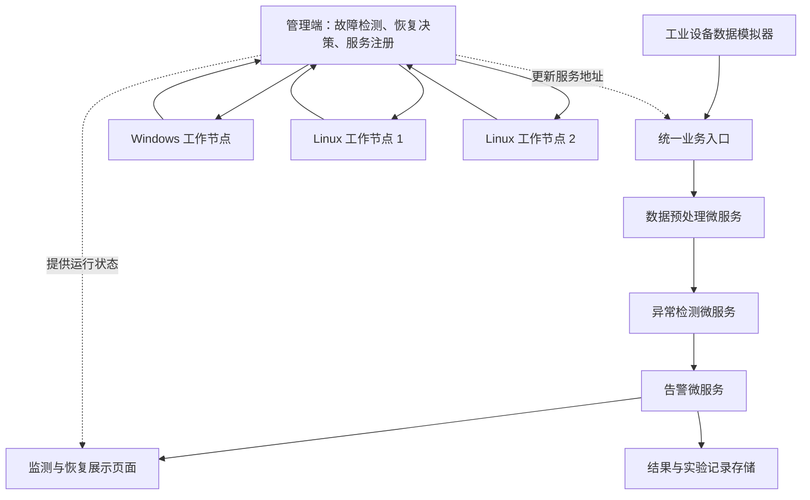

# 面向工业边缘节点故障的跨平台微服务重部署与恢复方法研究

> 工业互联网安全课程项目总体方案  
> 日期：2026年10月19日  
> 当前阶段：总体规划。本文给出项目框架、环境方案和实施阶段，暂不展开安装命令、接口定义及代码细节。环境配置为建议方案，尚未实际搭建或验证。

## 1. 项目定位与研究目标

本项目以工业设备状态监测为应用场景，构建运行在 Windows、Linux 异构节点上的微服务系统。当某个边缘工作节点发生故障时，系统自动识别受影响的服务，在满足兼容性和资源约束的节点上重新部署服务，并恢复监测业务。

项目围绕同一个系统完成三项课程成果：

| 课程成果 | 对应内容 |
| --- | --- |
| PPT 汇报 | 工业应用背景、相关研究、系统架构、恢复方法和实验设计 |
| 代码及展示 | 可运行的设备监测系统、故障注入、自动恢复和可视化展示 |
| 小论文 | 问题建模、方法描述、对比实验、结果分析与局限性 |

### 1.1 核心研究问题

在满足操作系统兼容性和资源约束的前提下，综合考虑节点负载、服务启动开销和通信开销，能否缩短工业边缘节点故障后的业务恢复时间？

### 1.2 项目范围

- 应用场景：模拟电机或水泵的温度、振动、电流监测。
- 操作系统：Windows 与 Linux。
- 初始规模：三个工作节点、三个核心业务微服务、一个管理端。
- 故障范围：服务进程崩溃、单个工作节点失联或关闭。
- 恢复方式：在目标节点重新启动对应平台的服务程序，验证健康状态后切换访问地址。
- 第一版假设：管理端、数据源及独立存储保持正常。

这里的跨平台恢复，是在目标操作系统上启动该服务对应的程序及运行环境，不涉及运行中进程的内存迁移。第一版不研究管理端高可用、多节点同时故障或硬实时控制。

## 2. 工业业务场景与整体架构

### 2.1 工业业务链

设备数据生成 → 数据预处理 → 异常检测 → 告警 → 结果展示。

数据模拟器生成正常数据和异常数据，每条数据具有唯一编号。预处理服务完成基础清洗与格式转换，异常检测服务识别异常，告警服务生成告警记录。第一版可采用阈值规则检测，优先验证故障恢复机制。

### 2.2 总体架构

系统分为工业业务部分和运行管理部分。下图中的业务微服务部署在工作节点上，具体位置由部署与恢复策略决定。

### 2.3 主要模块

| 模块 | 主要职责 |
| --- | --- |
| 工业数据模拟器 | 生成正常及异常设备数据，为数据分配唯一编号，保留短期缓冲 |
| 业务微服务 | 完成预处理、异常检测和告警，形成完整监测业务 |
| 节点代理 Agent | 上报操作系统、资源占用和服务状态，执行服务启动与停止 |
| 故障检测模块 | 结合心跳与服务健康检查，识别节点失联或服务异常 |
| 恢复决策模块 | 筛选兼容且资源充足的节点，选择服务恢复位置 |
| 服务注册与业务入口 | 维护当前有效服务地址，恢复后切换业务访问位置 |
| 数据与实验记录模块 | 保存业务结果、故障事件、恢复过程和性能数据 |
| 展示页面 | 显示设备曲线、节点状态、服务位置和恢复时间线 |

### 2.4 故障恢复流程

发现故障 → 确认受影响服务 → 筛选兼容节点 → 选择恢复位置 → 启动服务 → 验证恢复 → 更新访问地址 → 持续检查业务。

恢复成功应以业务重新持续成功处理为依据，不能仅以进程启动作为完成标志。

### 2.5 数据与状态处理

第一版让核心计算服务保持无状态，将结果和必要状态保存在工作节点之外的独立存储中。数据源结合短期缓冲、请求重试和数据编号去重，记录恢复期间的数据丢失与重复处理情况，不预先承诺零丢失。

节点失联后，应通过有效实例标识或租约等机制，避免旧实例重新连通后与新实例同时产生有效结果。带历史窗口的检测、检查点与状态恢复可作为后续扩展。

## 3. 环境搭建方案

### 3.1 实现路线

建议采用“真实 Windows/Linux 运行环境 + 轻量节点代理 + 自定义恢复调度器”。初期使用原生进程部署，后续根据课程要求和完成情况增加 Docker 等工具。

| 环境角色 | 建议配置 | 用途 |
| --- | --- | --- |
| 管理端 | Windows 或 Linux 主机 | 运行控制器、业务入口、记录存储和展示页面 |
| 工作节点 W1 | Windows 原生 Python 环境 | 运行 Windows 侧代理与业务微服务 |
| 工作节点 L1 | Ubuntu 24.04 LTS 虚拟机或实体机 | 运行 Linux 侧代理与业务微服务 |
| 工作节点 L2 | 第二个 Ubuntu 节点 | 提供备用恢复位置，构造不同负载条件 |
| 网络 | 同一局域网或可互通的虚拟网络 | 支持心跳、业务通信与管理接口 |

以上为逻辑角色，不要求每个角色独占一台物理电脑。可利用组员电脑组成节点，也可在一台电脑上运行小规模原型。

### 3.2 软件环境

| 功能 | 建议工具 | 说明 |
| --- | --- | --- |
| 业务服务、管理端与节点代理 | Python 3.12 | 各节点统一 Python 小版本与依赖版本 |
| HTTP 接口与健康检查 | FastAPI、Uvicorn | 提供业务接口与管理接口 |
| CPU、内存和进程监测 | psutil | 统一采集 Windows、Linux 节点信息 |
| 数据与事件记录 | SQLite | 由管理端服务统一访问，避免各节点直接共享数据库文件 |
| 展示页面 | Streamlit | 展示设备状态、节点状态和恢复过程 |
| 实验分析与绘图 | pandas、Matplotlib | 处理 CSV 数据并绘制对比图 |
| Linux 运行环境 | Ubuntu 虚拟机或实体机 | 资源受限时可先用 WSL2 验证基本功能 |
| 版本管理 | Git | 管理代码、配置与实验说明 |

Ubuntu 24.04 LTS 的标准安全维护期限至 2029 年，可作为固定实验环境。psutil 支持 Windows 与 Linux，适合统一采集节点资源信息。正式搭建时再锁定各软件的具体依赖版本。

### 3.3 硬件与网络要求

- 单机原型可从 16 GB 内存配置起步，32 GB 更宽裕；实际需求随虚拟机和服务规模变化。
- 各节点需要能够互相访问业务接口、代理接口及健康检查接口。
- 工作节点应配置明确的资源上限，并预留恢复所需资源。
- 单机环境中的节点共享宿主机资源，实验需要说明这一限制，避免将共享资源争用误判为操作系统差异。
- 管理端与工作节点共用宿主机时，仅能验证逻辑节点、进程或虚拟机故障，不能据此声称系统能够承受整台宿主机失效。

### 3.4 异构性体现方式

建立“服务—操作系统兼容关系”，在调度前进行检查。可跨平台恢复的服务需要分别验证其 Windows、Linux 部署方式；存在平台专用依赖的服务只能恢复到兼容节点。

只在同一 Linux 环境中运行多个容器不足以体现本项目的操作系统异构性。若后续采用 Docker Swarm，需要明确自己的方法与平台自带服务调度、故障后重新调度机制的区别。

## 4. 恢复方法与对比实验

### 4.1 拟实现的方法

采用两层决策：

1. **可行性筛选**：排除操作系统不兼容、依赖不满足、资源不足或状态异常的节点。
2. **恢复位置选择**：在可行节点中，综合当前负载、预计启动时间和通信开销进行评分，选择恢复位置。

启动时间与通信开销可通过预先测量和运行记录估计。评分方式、权重和资源阈值在详细设计阶段确定。若没有可行节点，应明确记录恢复失败或等待原因。

该方法属于课程项目的拟研究方案，是否优于对比方法、是否具有文献层面的创新性，均需后续调研和实验验证。

### 4.2 对比策略

| 策略 | 用途 |
| --- | --- |
| 兼容节点轮询选择 | 基础对照方法 |
| 兼容节点最低负载选择 | 常见启发式对照方法 |
| 多因素综合评分选择 | 本项目拟实现的方法 |

三种策略采用相同的兼容性与资源约束、故障检测机制和业务恢复验证条件，仅改变恢复节点选择方法。

### 4.3 实验场景

| 场景 | 主要验证内容 |
| --- | --- |
| 正常运行 | 确认业务链完整，获取无故障时的性能基准 |
| 服务进程崩溃 | 验证服务级异常发现与恢复 |
| 单个工作节点失联或关闭 | 验证节点上受影响服务的重新部署 |
| 备用节点负载不同 | 检验恢复方法能否选择合适的位置 |
| Windows 与 Linux 之间恢复 | 验证兼容性判断及两种平台部署方式 |

### 4.4 评价指标

| 指标 | 定义或用途 |
| --- | --- |
| 故障检测时间 | 故障发生到系统确认故障的时间 |
| 业务恢复时间 | 故障发生到业务重新持续成功处理的时间 |
| 恢复成功率 | 在预先规定时间内完成恢复的比例 |
| 数据丢失率 | 在规定统计窗口及补偿等待期结束后，未完成处理的数据比例 |
| 重复处理率 | 根据唯一编号统计重复处理情况，区别原始处理与去重后的有效结果 |
| 恢复后响应延迟 | 检查业务时效是否恢复 |
| 节点资源占用 | 分析恢复位置的资源使用情况 |

各策略使用相同数据序列、数据负载和故障时刻，重复运行，比较平均表现与波动。计时口径、成功条件和统计窗口应在实验前统一；跨节点计时需要处理时钟差异，或采用管理端统一观测。

## 5. 完成项目的大步骤

| 阶段 | 主要工作 | 阶段成果 |
| --- | --- | --- |
| 1. 明确范围与调研文献 | 确定工业场景、故障类型和核心研究问题，查阅部署与恢复方法 | 项目范围说明、参考文献、初步对比方法 |
| 2. 完成总体设计 | 确定业务链、节点角色、兼容关系、恢复流程和指标 | 架构图、方法设计、PPT 初稿 |
| 3. 搭建异构实验环境 | 建立 Windows/Linux 节点，打通通信、代理与资源监测 | 可互通、可管理的节点环境 |
| 4. 实现正常业务链 | 完成设备模拟、业务微服务、结果记录和基本展示 | 无故障情况下可运行的监测系统 |
| 5. 实现故障恢复闭环 | 接入故障检测、节点选择、服务重启、地址切换与恢复验证 | 可自动恢复的系统原型 |
| 6. 实现方法与演示界面 | 加入对比策略、综合评分方法与故障注入入口 | 可重复演示、可切换策略的完整项目 |
| 7. 开展对比实验 | 在不同负载与故障条件下采集数据、分析结果 | 实验数据、对比图表、局限性分析 |
| 8. 完成课程材料 | 根据系统和实验结果完善 PPT、代码说明与小论文 | 三部分最终成果 |

## 6. 第一版交付范围与验收目标

第一版控制为：**两种操作系统、三个工作节点、三个核心业务微服务、一个管理端、三种恢复策略。**

完成后应能够演示以下过程：

1. 系统持续生成并处理工业设备数据，展示正常监测和异常告警。
2. 页面显示各节点的操作系统、资源状态与服务部署位置。
3. 对指定服务或工作节点注入故障。
4. 系统发现故障，依据兼容性和恢复策略选择目标节点。
5. 在目标节点启动服务，完成健康与业务验证，更新访问地址。
6. 业务继续运行，页面显示恢复时间线和服务位置变化。
7. 导出实验记录，用于不同策略的性能比较和论文图表。

核心验收目标是“故障发生—自动恢复—业务继续—指标可测”。完成这一闭环后，再考虑复杂检测模型、带状态服务恢复、多节点同时故障或容器化部署。

## 7. 环境与平台参考资料

以下为环境及平台机制的官方资料，不替代后续小论文所需的学术文献调研。

- [Ubuntu 发布与维护周期](https://ubuntu.com/about/release-cycle)：用于选择固定 Linux 实验环境。
- [psutil 平台支持](https://psutil.io/platform/)：用于核对 Windows、Linux 资源监测支持情况。
- [Docker Swarm 服务部署机制](https://docs.docker.com/engine/swarm/services/)：用于了解现有服务部署与重新调度机制。
- [WSL 网络应用访问说明](https://learn.microsoft.com/windows/wsl/networking)：采用 WSL2 验证时，用于核对网络访问方式。
